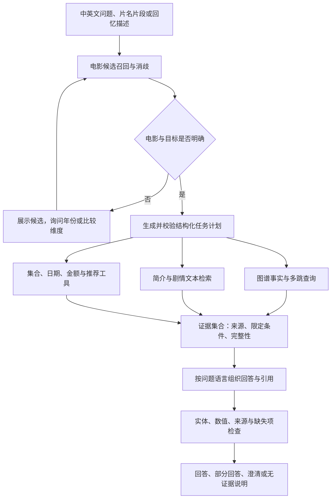

# 开放式电影问答扩展设计

日期：2026-10-30。状态：设计方案，尚未实施本文件中的新数据采集、模型训练和新增能力。现有代码仍以四关系的受限问法适配为准。

## 1. 推荐路线与边界

推荐建设 **中英文电影检索 + 结构化任务规划 + 图谱/文本证据查询 + 有来源的回答生成**。模型负责理解与表达，查询工具负责取事实、集合运算和数值计算。

先实现可验证的查询与检索，再评估是否需要微调和结构向量融合。Qwen3-8B 作为推荐骨干，沿用已有第二阶段设计；没有假定它是当前最新或本任务最优的模型。当前同伴的 5000 部四关系训练继续作为基线，原数据文件不修改。

本方案扩展的是同一批 5000 部电影的能力，称为 V2。它不等于既有《第二阶段实验详细设计》中与旧电影不重叠的独立 D2 数据集，也不能把不同任务的分数混为一次消融。

系统承诺在当前资料、知识库范围内回答。未收录、来源不足、问题仍有歧义时继续澄清或说明缺失，不能承诺任意电影问题都可回答。

## 2. 各类问题如何解决

| 能力 | 所需数据 | 执行方式 | 训练依赖 |
|---|---|---|---|
| 不完整片名、错拼、中文别名 | 中英文标题、别名、年份、系列标识 | 片段/字符检索、拼音候选、向量召回、候选确认 | 基础检索可直接实现；重排可另行微调 |
| 凭剧情回忆找电影 | 有许可的简介/剧情文本 | 文本检索后返回候选电影，先确认再回答 | 可先使用预训练多语向量模型 |
| 演员、编剧 | 出演、角色、配音演员及编剧事实 | 指定关系查询，保留多答案、分页和来源 | 先不要求重训生成模型 |
| 上映日期 | 日期、地区、精度及发行事件说明 | 按地区/事件查询，展示多条日期 | 工具与模板先实现 |
| 预算/成本、票房 | 金额、币种、统计范围、时间、来源 | 读取有类型的数值；缺失时保留未知 | 不依靠模型记忆补值 |
| 剧情介绍 | 可引用的文本段落、页面修订与许可 | 检索相关段落后生成摘要、标注出处 | 生成模型可先零样本使用 |
| 同片多个属性 | 各属性的独立事实 | 拆成多个子查询，再合并回答 | 任务规划先提示词，后按需微调 |
| 多部电影比较 | 明确实体、比较维度及可比数值 | 分别取事实，集合/日期/数值工具比较 | 不让生成模型自行算账 |
| 多跳问题 | 可连接的图边与查询计划 | 执行两至三步只读查询，展示路径 | 可先用显式查询模板，再训练规划器 |
| 推荐 | 类型、人物、简介特征和用户条件 | 条件过滤、相似度排序、解释推荐依据 | 无需先有用户行为数据；交互学习后续再做 |
| 制作国与拍摄地 | 两类不同属性 | 对应不同字段与不同工具参数 | 先修正数据语义 |
| 原始语言与配音语言 | 原片属性，以及具体配音/发行版本 | 绑定版本后查语言，版本不明时澄清 | 缺少版本证据时不推断 |

演员名单不自动等于主演名单；相似推荐不自动等于客观质量排序；没有记录某演员不自动证明其未出演。

## 3. 总体结构



建议保留现有网页入口。底层增加五个模块：数据适配、电影检索、任务规划、工具执行、证据回答。不需要为 5000 部电影立即部署复杂图数据库；结构化事实可先用 SQLite，文本和别名向量可使用 FAISS，原 JSON/TSV 作为冻结交换格式。

模型输出 JSON 计划，不直接提交任意 SQL/SPARQL。应用将经过校验的电影 QID、属性、过滤条件与运算映射到白名单工具，限制跳数和返回规模。公开资料采集与实时问答分离，默认问答读取冻结本地库。

## 4. 数据 V2：扩关系与保留限定条件

### 4.1 推荐的 Wikidata 字段

以下属性名称与说明于 2026-10-30 通过官方实体 API 核对。存在属性不表示每部电影都有完整记录。

| 问题对象 | 主要属性 | 处理要求 |
|---|---|---|
| 导演 | P57 | 保留多位导演 |
| 类型 | P136 | 保留多类别，不强制单分类 |
| 制作国/原产国 | P495 | 不解释为拍摄地或故事发生地 |
| 原始语言 | P364 | 绑定原片，不解释为所有发行版本语言 |
| 演员 | P161 | 保存 P453 角色限定；名单不默认完整，不默认等于主演 |
| 配音演员 | P725 | 与真人出演区分；有版本/语言证据才绑定具体配音版 |
| 编剧 | P58 | 保留多人及来源说明 |
| 发行/上映日期 | P577 | 保存地区等限定条件、日期精度、历法和原值 |
| 拍摄地 | P915 | 实际拍摄地点 |
| 故事地点 | P840 | 剧情设定地点 |
| 制作成本 | P2130 | 其定义是生产/制作的成本金额；来源明确称预算时才标记为预算 |
| 票房 | P2142 | 保存币种、地区/全球范围、统计时间等；范围不明就标记不明 |

P1545 是一般的序号限定属性，不自动证明演员为主演。只有来源明确说明主演或出场排序，才使用相应语义。

配音语言没有可对全部电影统一套用的简单规则。建立 `FilmVersion`，字段至少包括原片 QID、版本标识、语言、发行地区和来源；可在有明确版本实体与说明时使用 P407。P407 本身是作品/名称语言属性，不能据此猜测电影有哪个配音版。

### 4.2 数据表达

事实记录保留：`statement_id / subject / predicate / object_type / value / unit / precision / qualifiers / rank / references / source_url / revision / retrieved_at`。

- 实体关系使用 QID；日期使用带精度的规范值；金额使用十进制定点值和币种，不转成漂浮的字符串实体。
- 日期和金额供工具计算；人、电影、类型等实体关系供图查询和图嵌入使用。
- 同值不同来源可合并来源列表；同属性不同地区、币种、日期或范围不能直接去重掉。
- 缺失不是零；未知币种不是默认美元；没有地区的票房记录不是默认全球票房。
- 同时存在多条冲突记录时保留原记录，按可比条件选择或展示冲突，不让模型自行挑最方便的一条。
- 中文名称优先用有来源的中文标签，缺失时保留原名；不把模型自拟译名当官方别名。

先对 200 部覆盖不同年代和国家的电影采样，统计每个字段的覆盖率、来源比例、冲突率、币种/地区缺失率与演员数量分布，再决定哪些能力可向用户开放。不能只挑信息完整或模型容易答对的电影计算成绩。

### 4.3 剧情与简介文本

Wikidata 四关系/扩展属性不足以直接提供剧情概述。推荐增加 Wikipedia 等可合法使用的文本来源；TMDB 作为可选补充，先核对 API、署名及再分发条件。

每个文本块记录电影 QID、语言、章节、页面 URL、修订号、提取时间、许可和署名信息。来源不确定或许可不允许再分发时，不把原文打包进 GitHub；按许可保存可分发资料、引用链接及适当处理后的产物。Wikidata 的 CC0 不能自动套用于其他网站文本或图片。

剧情摘要从检索段落生成，附来源，默认采用简要介绍；详细剧情可提供剧透选项。找不到合适段落时说明资料不足，不使用模型记忆伪造引用。

## 5. 电影不记得全名：先找候选，再确认

### 5.1 候选索引

保存中英标题、实际别名、年份、系列、国家及可用简介。原始写法保留，另建 NFKC、空白/标点标准化、简繁归一索引和可选拼音索引。拼音只用于召回，不能把同音电影视为同一实体。

召回采用三路：

1. 字符 n-gram/关键词检索：适合“盗梦”“Avenger”等片段。
2. 编辑距离：适合轻微拼写错误；数字续集、年份和短标题单独校验。
3. 多语文本向量检索：适合“能进入别人梦境的电影”等描述，需要剧情文本才能工作。

合并前约 20 个候选，再按标题、年份、系列、问题上下文重排，展示前 3—5 个。剧情描述优先召回电影，回答其他属性前先确定是哪部。

### 5.2 选择策略

- 明确 QID 或无歧义完整别名可以直接进入查询。
- 第一版对残缺片名、语义回忆和低置信度近似匹配都显示候选卡片，由用户确认。
- 有了独立开发集后，再校准自动接受阈值和候选分差。检索分数不直接称为概率。
- 候选卡片显示名称、年份、国家和 QID；海报属于可选有许可资源。
- 知识库缺少所问续集时，不把它自动降级成已收录的前作。

“找电影”和“查电影事实”分开返回状态；检索没有可靠候选时继续询问线索。

## 6. 问题理解：从单关系改成任务计划

使用中英文模型将问题解析为 `task_type / entities / operations / constraints / requested_language / missing_information`。任务类型为事实查询、摘要、比较、推荐和澄清。

### 6.1 多意图与多个电影

“盗梦空间谁导演、谁出演？”变为同一电影的 P57 与 P161 两个查询。导演已知、演员缺失时，回答已知部分，并单独说明演员信息缺失。

“盗梦空间和星际穿越的导演、上映日期分别是什么？”先消歧两部电影，再分别查属性，输出带来源的比较表。某个日期缺少地区时保留说明，不让表格省略限定条件。

“哪个更好看？”先询问偏好的类型、节奏等维度，或给有明确依据的推荐理由，不把主观结论写成知识图谱事实。没有采集评分数据时不自动编造评分。

### 6.2 多跳查询

“盗梦空间的导演还拍过哪些电影？”可执行：

```text
Inception --P57--> Christopher Nolan
Christopher Nolan <--P57-- 其他电影
排除 Inception，限定当前片库，按要求排序并返回路径
```

由工具执行反向边查询与集合过滤。回答应说“当前片库收录的作品包括……”，不能等同于导演全球完整作品表。

“两部电影有哪些共同演员？”执行两个 P161 集合的交集；“共同编剧”同理。导演有多人时按人分组或澄清，不只取第一人。初版支持两跳，稳定后扩到三跳；超出工具范围时说明限制。

结果较多时分页并显示总数。不能静默沿用现有前 24 条事实、384 输入 token 或 96 输出 token 的截断策略，然后把不完整答案称为完整答案。

### 6.3 数值和日期比较

“哪个票房高？”必须先确定两部电影，以及全球/地区、币种和统计口径。只有币种与范围可比时，工具才计算差额和排序。不同币种的比较需要明确换算日期及汇率来源；初版不默认换算，不默认做通胀调整。

“什么时候上映？”可先展示当前资料中最早的有来源发行记录及地区，称“最早记录”，不保证它就是全球首映。问指定地区时过滤地区；问某年某国上映的电影时执行日期/地区过滤，保留日期精度。

## 7. 推荐：先做可解释的内容推荐

先询问或读取本次会话中的类型、语言、年代、导演/演员偏好及排除项，再进行：硬条件过滤 → 类型/人物/简介相似度排序 → 可选多样性重排 → 给出推荐理由。

没有历史交互时采用内容推荐，不声称实现了协同过滤。理由来自已有事实，例如“同导演、同类型”，不能编造“你一定喜欢”或不存在的评分。用户提供的偏好是会话条件，若需长期保存需在产品中明确选择。

推荐只覆盖当前片库；结果不足时说明哪些条件导致不足。排名质量由相关性标注或人工评价检验，没有真实标注时不制造 NDCG 金标准。

## 8. 模型与融合设计

| 模块 | 推荐起点 | 为什么这样分工 |
|---|---|---|
| 中英文任务规划、证据回答 | Qwen/Qwen3-8B | 与既有第二阶段骨干一致；两种角色使用不同提示词/训练任务 |
| 名称、回忆描述、文本召回 | Qwen/Qwen3-Embedding-0.6B | 处理多语相似检索，仍需验证实体召回质量 |
| 候选重排 | Qwen/Qwen3-Reranker-0.6B | 仅对少量候选排序，先与简单字符检索比较 |
| 图嵌入 | TransE 与 ComplEx | 在相同 V2 图谱和同一生成骨干下比较结构表示 |
| 执行与计算 | SQLite、Python 类型化工具 | 明确查询路径、集合结果、金额和日期口径 |

以上三个 Qwen 模型仓库及 Apache-2.0 标签已通过官方模型 API 核对；上线前仍需锁定具体 revision、依赖、模型卡和实际输入/输出表现，不以模型卡替代本任务评测。

### 8.1 先提示词和工具，再按错误决定微调

先用预训练骨干完成结构化计划、工具查询与引用回答，不等待新的大规模 SFT。若错误主要在实体、资料缺失或金额口径，优先修数据/工具；若错误主要是中英文意图和计划不稳定，再训练规划器。

规划训练样本为“问题 → JSON 计划”，生成训练样本为“问题 + 工具证据 → 带引用回答”。包含澄清、部分可回答、无证据拒答及中英文等价样本。问题和引用都经校验；自动起草样本需标记来源并抽查。

LoRA 初始试验建议：r=16、alpha=32、dropout=0.05，最大上下文 4096，有效 batch=16，先试 2 个 epoch、学习率 1e-4；比较 3e-5/1e-4/3e-4，随机种子 42/43/44。均为待验证起点，不是最佳参数结论。正式试验固定训练预算、初始化、上下文与解码设置，按验证集选择配置。

### 8.2 图融合是独立实验，不阻塞其他功能

实体关系图可训练并冻结 TransE/ComplEx，用于候选路径排序或问题引导的结构前缀；日期、金额和剧情文本仍通过相应工具检索。向量给出的相似或高分候选必须能回到实际证据，不作为已知事实直接回答。

先比较无向量的证据文本生成器，再加入既有第二阶段提出的问题引导事实选择、门控/注意力融合。检查结构向量是否真正改善证据选择，而非仅增加参数。

一个可控的维度对照是 TransE 200 实数维与 ComplEx 100 复数维（200 实数维）；h/r/t 拼接均为 600 实数维，再投影到骨干配置中的 hidden size。代码从配置读取维度，不沿用现有写死的 300。比较时记录实体、关系参数量和投影参数量；实际训练维度可在预跑后冻结。

V2 新增关系/实体后必须重建映射和训练配套嵌入。旧 5000 部四关系向量保留给旧实验；同架构生成权重可作为单独微调起点，但不能把 T5 权重直接加载到 Qwen，也不能把旧投影假装已经适配新向量。

## 9. 数据集与评测：避免任务和训练泄漏

### 9.1 三条版本线

- V1：现有 5000 部四关系冻结数据与同伴正在训练的模型，保持不变。
- F1：已另存的 86974 道英文受控改写，用于现有关系的下一轮问法训练，不是独立人工测试。
- V2：同一电影集合扩展事实、文本、类型化答案与任务计划。独立存储，不覆盖 V1/F1。

单电影题继续继承电影的 70%/15%/15% 划分；中英等价句、改写、别名、噪声及同源衍生题作为同组。训练/验证/测试的表达族预先分开。

多电影题要求问题涉及的电影均属于同一划分，跨划分问题不进入训练。多跳题若完整答案涉及其他划分的电影，保留完整答案，将整题放入独立跨实体评测轨；不能截掉跨集合答案来伪造隔离。报告实际可生成数量，跨实体轨不和单电影轨混算。

图嵌入可使用完整冻结知识库，因此评价的是已知知识库上的新问句/新任务，不声称推断从未见过的电影事实。

### 9.2 人工自然问题集

建议最终另建 400 道自然题，中英各 200，和开发题分开：

| 组别 | 题数 |
|---|---:|
| 事实查询 | 120 |
| 残缺片名、错拼和歧义 | 80 |
| 多意图、多电影与比较 | 60 |
| 多跳 | 40 |
| 剧情摘要 | 30 |
| 推荐 | 30 |
| 不可回答 | 40 |
| 合计 | 400 |

尽可能由未参与该批模板编写的人提供问题。两人独立核对事实、完整性与引用，保留各自原始评分和分歧。若独立编写资源不足，必须说明折中，不能将自动改写称为人工独立测试。

### 9.3 指标按答案类型选择

| 对象 | 主要指标 |
|---|---|
| 电影候选 | Recall@5、Top-1、错误自动接受率、澄清成功率 |
| 实体列表 | QID 集合准确率/F1、相对当前资料的完整性 |
| 日期 | 日期值、精度和地区匹配 |
| 金额 | 数值规范化、币种、范围和时间匹配；容差规则提前确定 |
| 任务计划 | 实体/关系/约束正确率、计划可执行率 |
| 多跳/比较 | 最终结果、路径/操作有效性、限定条件一致性 |
| 摘要 | 人工事实准确性、覆盖、引用支持；ROUGE 等仅为辅助 |
| 推荐 | 有标注时的排序指标，以及人工相关性、解释真实性、多样性 |
| 不可回答 | 拒答 Precision/Recall、无依据回答率、部分回答正确性 |
| 成本 | 冷/热启动、batch=1 端到端平均/P95、吞吐、训练 GPU 小时 |

引用存在性检查只能证明引用能找到，不能自动证明整段生成文字受其支持；事实精度仍需结构化对照和人工抽查。

第一版可设工程目标：开发集候选 Recall@5≥95%、有证据事实准确率≥95%、不可回答题无依据回答率≤2%。这些是拟定验收目标，不是已得到的结果；阈值在开发集定好后再冻结测试，不能用测试结果调参。

## 10. 分阶段实施与当前训练的衔接

| 阶段 | 必须完成 | 可否与当前训练并行 | 放行条件 |
|---|---|---|---|
| M0 | 200 部扩字段采集、语义/许可审查、基础工具 | 可以 | 覆盖率与限定条件统计可查，缺失不造值 |
| M1 | 部分片名、错拼、候选确认与已支持四关系 | 可以 | 错误匹配和澄清流程通过开发集验证 |
| M2 | V2 冻结、演员/编剧/日期/金额、多意图与比较 | 可以 | 类型化查询、完整性、单位和地区检查通过 |
| M3 | 简介检索、两跳、内容推荐、Qwen 工具规划 | 可以先做预训练模型验证 | 每项能回放计划和证据；未支持任务仍能说明限制 |
| M4 | 按错误分析开展 LoRA，比较结构融合 | 当前基线完成后另开运行 | 固定数据、相同任务/预算、独立评测和消融 |

优先顺序：候选电影确认 → 扩事实与类型化工具 → 多意图/比较 → 文本摘要与两跳 → 推荐 → 再决定哪些环节值得训练。

当前训练可以继续。若只增加检索、查询和模板回答，通常无需等它训练完成；若改变神经输入、学习新的关系/计划或换骨干，则在 V2 冻结后另开训练。原运行保留为基线，新增训练记录实际代码版本、数据/映射/模型版本和题数。

计算资源建议先用单卡 24—48 GB 做 Qwen 8B 推理/QLoRA 预跑，具体可行上下文和微批大小以实测为准。数据采集与大部分工具开发用 CPU 即可。正式租用预算用 100 步预跑的吞吐估计：总训练时间≈总优化步数×每步秒数，再加验证、推理、重跑和下载成本；当前不预填未测得的 GPU 小时或总价。

## 11. 验证实验与最小交付

独立实验路线见 [EXPERIMENT_PLAN](../refine-logs/EXPERIMENT_PLAN.md) 与 [EXPERIMENT_TRACKER](../refine-logs/EXPERIMENT_TRACKER.md)。当前旧 A0/T5 的四关系结果保留为历史背景；比较新模块时必须在同一 V2 资料和同一套问题上运行。

最小交付包括：版本化图谱/文本及许可清单、实体候选索引、任务计划 schema、只读工具、双语证据回答、可回放日志、400 题评测材料和实际统计。长列表分页、缺失字段、币种、地区、引用与澄清都应在 UI 可见。

本次仅形成设计文档及待执行实验表，未采集 V2、未租服务器、未启动新训练、未声称上述能力已经上线。

## 12. 参考入口

- [Wikidata 属性实体 API](https://www.wikidata.org/w/api.php?action=wbgetentities&ids=P161%7CP58%7CP577%7CP915%7CP840%7CP495%7CP364%7CP2130%7CP2142%7CP407%7CP725%7CP1545%7CP453&props=labels%7Cdescriptions&languages=en%7Czh&format=json)
- [演员 P161](https://www.wikidata.org/wiki/Property:P161)、[编剧 P58](https://www.wikidata.org/wiki/Property:P58)、[日期 P577](https://www.wikidata.org/wiki/Property:P577)
- [拍摄地 P915](https://www.wikidata.org/wiki/Property:P915)、[故事地点 P840](https://www.wikidata.org/wiki/Property:P840)、[原产国 P495](https://www.wikidata.org/wiki/Property:P495)
- [原始语言 P364](https://www.wikidata.org/wiki/Property:P364)、[作品语言 P407](https://www.wikidata.org/wiki/Property:P407)、[配音演员 P725](https://www.wikidata.org/wiki/Property:P725)
- [制作成本 P2130](https://www.wikidata.org/wiki/Property:P2130)、[票房 P2142](https://www.wikidata.org/wiki/Property:P2142)、[Wikidata 许可](https://www.wikidata.org/wiki/Wikidata:Licensing)
- [Qwen3-8B](https://huggingface.co/Qwen/Qwen3-8B)、[Qwen3-Embedding-0.6B](https://huggingface.co/Qwen/Qwen3-Embedding-0.6B)、[Qwen3-Reranker-0.6B](https://huggingface.co/Qwen/Qwen3-Reranker-0.6B)
- [Wikipedia 内容再使用说明](https://en.wikipedia.org/wiki/Wikipedia:Reusing_Wikipedia_content)、[TMDB FAQ](https://developer.themoviedb.org/docs/faq)
