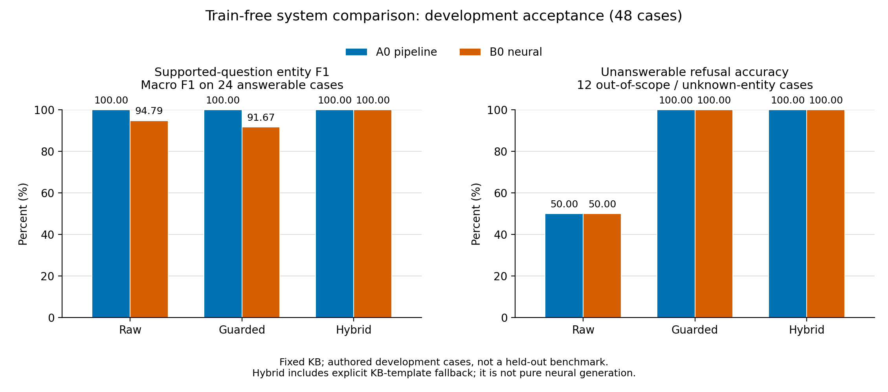
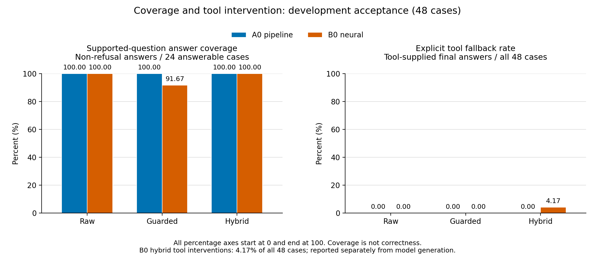

# 电影知识图谱问答无需训练增强与报告补充

日期：2026年10月31日。本文记录截止提交前完成的系统增强、复现方法和实验口径。新增系统不更新模型参数；原始A0、神经模型权重、冻结数据和既有主实验指标保留。此扩展用于改善交互可靠性，不能代替原始神经网络实验。

## 实验目的与路线

自由表达中的实体歧义、范围外属性、未执行条件及生成错误，不能仅靠继续训练解决。本轮在冻结模型外增加明确的解析和证据检查，并比较保守拒答与工具回退的收益和代价。

流程为：中英文问题 → 识别电影与属性 → 歧义澄清及范围检查 → 标准问法 → 原A0或冻结神经模型 → 关系与实体核验 → 接受、拒答或显式工具回退。

实现位于`kgqa/freeform.py`、`kgqa/guarded.py`和`kgqa/web.py`。解析器版本为`bounded_rules_v2`，核验器版本为`evidence_guard_v1`。

## 实现内容

1. 复用既有中英文片名、中文展示目录、别名和年份信息。相似匹配需要确认，避免把猜测的片名直接用于回答。
2. 将明确的导演、类型、制作国家及原始语言问题转换成标准英文输入。否定、排除、日期筛选、比较、数量和无法解释的残留条件不静默删除，进入澄清或拒答。
3. 区分原始语言与对白/配音语言，区分导演与“掌镜”。扩展演员等属性仍由独立十二属性工具入口处理，不并入四关系神经模型成绩。
4. 神经增强入口按问题属性筛选原先最多24条可见事实，文本和TransE向量同步选择，不重新训练嵌入或投影。核验检查所问属性的实体集合与多答案完整性。
5. 为避免“实体出现就当正确”，仅接受与已核实事实一致的两种已知完整句式；其他自由表述也可能被保守拦截。此限制会影响覆盖率，不能称为通用事实核查器。
6. 工具回退仅在电影、属性和事实均明确时执行完整属性查询及模板回答，保留`raw_answer`、`guard.reason`、实际模型证据和`fallback_used`。回退结果属于混合系统，不计为纯神经生成成功。
7. 界面默认勾选“自由问答增强 · 证据核验”，显示澄清候选、最终事实证据、原始输出与工具介入。取消勾选可查看原始标准入口。

## 对照设置与评价协议

每个可运行的系统分别运行三种配置：原始入口`raw`；规范化、范围门控、关系证据筛选和核验但不补答的`guarded`；在前者基础上允许工具模板回退的`hybrid`。本轮是组合策略对照，未分别量化每个组件的独立贡献。

使用`benchmarks/trainfree_challenge_v1.jsonl`的48道程序编写中英开发验收题，24道可答、24道不可答或需澄清。可答题的电影与属性在运行前声明，参考实体从固定KB读取，不从模型答案生成。验收题在开发阶段使用并暴露实现问题，绝非新的独立测试集，也不是人工评分；其中电影可能属于训练集合。不能据此宣称真实用户自由问答准确率或未知电影泛化能力。

主要记录可答实体F1、电影与实体集合同时正确率、不可答拒答率、需澄清子集的允许状态匹配率、范围外非拒答代理率、覆盖率、工具回退率以及平均/P95延迟。原始神经响应不一定提供关系字段，不拿缺字段的“电影＋关系＋实体”指标与增强系统直接比较。拒答自动识别有局限，未识别的拒答改写需要人工核查。

延迟为逐题顺序运行的墙钟时间，初始化不计，首次查询开销保留，不作正式吞吐基准。不同数据、系统、设备、冷启动口径分开记录。

## 实测结果

最终主对照使用独立5000运行包中的A0与B0（原始验证集选中），六组已完成。清单绑定的输入、模型与源码在运行前后哈希一致，见`verification/2026-10-31/trainfree/runtime_5000_final_v2/manifest.json`及`summary.json`。源码绑定列表不覆盖全部间接依赖，其中`pipeline.py`另由解包覆盖清单绑定，事后核对与本机及运行包一致；该项不具有单独的运行前后双次校验，见`source_coverage.json`。本轮没有更新权重或追加训练。中间尝试均保留并在材料索引中标记。

| 配置 | 可答实体F1 | 电影与实体全正确 | 不可答拒答率 | 需澄清允许状态匹配 | 非可答作答代理率 | 工具回退率 |
|---|---:|---:|---:|---:|---:|---:|
| 原始A0 | 100.00% | 100.00% | 50.00% | 16.67% | 50.00% | 0.00% |
| A0增强核验 | 100.00% | 100.00% | 100.00% | 83.33% | 0.00% | 0.00% |
| A0增强与工具回退 | 100.00% | 100.00% | 100.00% | 83.33% | 0.00% | 0.00% |
| 原始B0 | 94.79% | 91.67% | 50.00% | 25.00% | 45.83% | 0.00% |
| B0增强核验 | 91.67% | 91.67% | 100.00% | 83.33% | 0.00% | 0.00% |
| B0增强与工具回退 | 100.00% | 100.00% | 100.00% | 83.33% | 0.00% | 4.17% |

可答分母为24题，不可答为12题，需澄清为12题；非可答代理分母为24题，工具回退分母为全部48题。神经混合系统实际有2题回退，即可答题的8.33%，全部题的4.17%。题集只涉及6部电影，中英问句各24题，中文主要为英文片名或QID与中文问题混合；24道可答题中16题的电影来自原train划分，8题来自原test划分。以上100%只描述这组开发验收，不是全库、任意自由提问或独立测试准确率。

**观察与解释。** 增强A0保留本组可答覆盖，主要收益是拦截范围外或含未执行条件的查询。B0严格核验把部分错误生成变成拒答，可答实体F1由94.79%降为91.67%，说明安全约束有覆盖代价；不能声称纯神经能力全面提升。允许工具回退后，2题通过明确的知识库查询补齐最终答案，形成混合系统的100%。这些提升不归因于模型学习或参数更新。本轮没有分别消融规范化、关系筛选和表面核验，不能判断单个模块的独立效果。

| 配置 | 平均延迟 | P95延迟 |
|---|---:|---:|
| 原始A0 | 6.30 ms | 3.07 ms |
| A0增强核验 | 19.41 ms | 38.29 ms |
| A0增强与工具回退 | 19.90 ms | 29.83 ms |
| 原始B0 | 886.11 ms | 1742.25 ms |
| B0增强核验 | 711.56 ms | 1816.33 ms |
| B0增强与工具回退 | 691.31 ms | 1811.20 ms |

环境为本机Windows、Python3.11.7、PyTorch2.6.0+cu124、RTX3070Ti Laptop GPU，CPU线程2。平均A0延迟大于P95，是少数首次查询耗时拉高均值；本轮不剔除该开销。B0增强对部分题在生成前拦截，因此全题平均延迟下降不代表生成器本身加速；小样本与同时进行的UI验证也会影响耗时，不能推断稳定性能提升。

本地5000 A0复跑核对（`expanded_5000_final_v2`，相同数据、模型、题集及源码）得到相同的主要正确性和拒答结果。这是目录与资产配对核对，不是独立数据或统计交叉验证。最终轻量回归567项通过、2项因可选神经依赖跳过；完整神经环境的针对性回归106项通过，真实神经生成与HTTP界面另外运行。截图为`verification/2026-10-31/trainfree/screenshots/`中的真实浏览器截图。





## 复现与使用

所有命令从项目根目录运行，使用项目内环境，不需要继续训练。

```powershell
# 本机已准备好的5000双系统增强版，推荐演示入口
.\scripts\run_trainfree_5000.cmd

# 默认已激活的5000电影A0页面
.\.venv\Scripts\python.exe -m kgqa.web --port 7863 --open

# 原始本地配套神经模型与1000电影数据，勿误标为5000神经版
.\.venv\Scripts\python.exe -m kgqa.web --legacy --port 7864 --open

# 5000电影A0单题，含核验及可追溯工具回退
.\.venv\Scripts\python.exe -m kgqa.guarded --data-dir data/processed/movies_5000_20261029 --model-path models/pipeline_5000_20261029/model.pkl --question "Who directed The Avengers?"

# 5000 A0与1000双系统分别评价，输出目录必须为空或不存在
.\.venv\Scripts\python.exe -m kgqa.trainfree_experiment --systems a0 --data-dir data/processed/movies_5000_20261029 --model-path models/pipeline_5000_20261029/model.pkl --output-dir output/trainfree_5000_new
.\.venv\Scripts\python.exe -m kgqa.trainfree_experiment --systems a0 neural --output-dir output/trainfree_1000_new
```

其他电脑已有完整运行包时，可在新目录加入当前增强代码。项目提供校验与隔离准备脚本，保留已有目录：

```powershell
.\.venv\Scripts\python.exe scripts/prepare_trainfree_runtime.py --archive .work/v100-freeform/AI_1_experiment_5000_runtime_20261030.zip --destination .work/trainfree_5000_runtime_20261031_final
```

脚本校验运行包清单后将当前`kgqa`代码及验收题复制到新解包目录，不改运行包的数据和模型。随后进入`.work/trainfree_5000_runtime_20261031_final/AI_1_experiment`运行界面或评估命令；用原项目解释器绝对路径启动。正式5000主对照正是在该目录执行，而非主工作区的1000电影默认路径。

神经模式需要原有完整依赖与本地检查点，A0模式不需要安装PyTorch。HTTP接口使用`POST /api/answer`，JSON中指定`mode="guarded"`、`system="a0"/"best"/"both"`。接口默认仍为`standard`，保持已有调用的含义。前端默认开启增强，导出JSON保留处理过程。

## 可写入报告5.1至5.5的内容

**5.1 目标与设计。** 在已有知识图谱管道和Transformer生成模型的基础上，研究不更新权重的输入适配与证据约束方法。问题范围为冻结知识库中的四类单跳事实，扩展工具单独展示。

**5.2 实现方法。** 增加双语有界解析、条件保护、实体候选确认、按关系选择事实、完整句与实体集合核验。混合系统在核验失败时使用明确标记的图谱查询模板，原始生成保留用于错误分析。

**5.3 实验过程。** 冻结代码和输入资产，运行三组对照，逐题保存解释、输出、证据、耗时与参考来源，校验运行前后数据和模型哈希。既有训练实验另行保留；本轮增强没有新增训练耗时。

**5.4 结果与分析。** 采用本文件最终结果表，分别讨论可答覆盖、拒答、澄清与工具介入率。实体F1高不意味着生成文本全部正确，工具回退也不意味着模型自身学会回答。不得把开发验收结果当成人工评价或独立测试成绩。

**5.5 总结与改进。** 无需训练即可增加可解释的范围保护和事实查询保障，但保守语法可能拒绝合法的新表达，严格句式核验可能引发较多回退。下一步使用独立人工中英挑战集评价，再考虑冻结大模型规划器和语义检索；本轮未部署Qwen或完成该项评测。

## 既有自由问法训练的说明

此前服务器训练已完成，不能写成“因时间不足尚未训练”。新模型在已披露自由问法测试集上的实体F1为69.408073%，拒答准确率为58.333333%；该集成绩与本轮开发验收不直接比较。新检查点尚未切换到当前UI。训练的验证收益与拒答退化见`docs/自由问法训练启动记录_20261031.md`，本次截止前采用冻结旧模型的系统增强路线，不再追加训练。

## 提交前核对

原始主实验结果、参数对比与人工评价材料按既有来源使用；本补充不能替代未完成的真人评分。截图应来自实际运行界面与终端，不能绘制或模拟。提交代码保留原数据版本和模型来源，CI不依赖下载大型模型。报告中的完成事项、尚未完成事项和本次证据范围分别写清。
