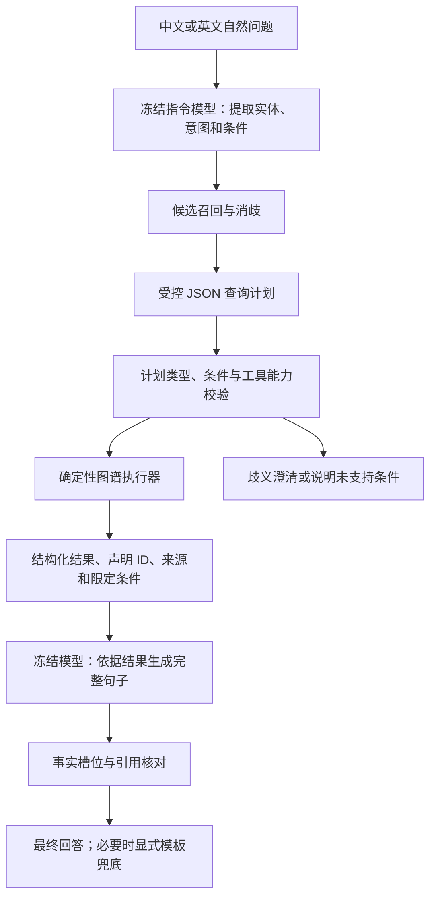

# 自然语言理解升级方案：冻结模型规划与知识图谱执行

日期：2026-10-31。本文是针对当日提交期限收敛后的设计，未实现的步骤明确标为待办，不作为新的实验成绩。此前服务器自由问法训练已完成；本方案不追加训练。既有四关系主实验、模型和冻结数据继续保留。

## 实施后的状态

下文保留设计时的核查与候选选择，不将最初的“尚无服务”当作当前状态。现已实现独立P0入口、受控计划与图谱执行，并部署冻结`Qwen/Qwen2.5-3B-Instruct`，revision为`aa8e72537993ba99e69dfaafa59ed015b17504d1`；未采用设计候选Qwen3-8B，也未更新模型权重。5000电影启动脚本现已传入外部V2目录。

20道程序编写开发题已完成真实模型调用，中英各10题，仅涉及两部电影。P0计划匹配7/16，低于D0的12/16；状态匹配14/20，高于D0的12/20；P0模板回退11/20。它们不足以证明泛化或全面优于规则。独立40题、人工文本评分及新P0浏览器截图仍未完成。运行方法见[P0使用说明](P0冻结语义问答使用说明.md)，逐题输出见[开发验收](../verification/2026-10-31/semantic_p0/dev_v1/)，完整记录见[BUILD_NOTE](../implement-stage/semantic-qa-20261031/BUILD_NOTE.md)。

## 当前系统做到哪里

用户提供的任务描述要求理解自然语言问题、从知识图谱检索事实，并生成完整流畅的句子。截图没有要求开放域、任意关系问答，也没有规定只能做四类。四关系可以构成一个有界任务；但只在固定规则覆盖的表达上成功，不足以证明具备广泛的自然语言理解能力。

此前“自由问答增强”的表述偏宽，应改成“四关系中英文问法适配与证据核验”。现有 FLAN-T5 神经生成是真实实现，新增规则主要改善规范化、拒答和可靠性，没有让旧模型获得任意语义规划能力。

| 层次 | 2026-10-31 本地核查 | 实际限制 |
|---|---|---|
| 主问答 | `kgqa/common.py` 的 `RELATIONS` 只有导演、类型、制作国、原始语言 | A0/B0 主实验仍为四关系任务 |
| 自由问法 | `kgqa/freeform.py`，`bounded_rules_v2` | 有限规则；许多比较、数量、日期、否定问题被阻断 |
| 生成核验 | `kgqa/guarded.py` | 严格已知句式及实体集合核验；保守但限制自然表述 |
| V2 数据 | 5000 部电影、170516 条声明，约 322.65 MiB | 12 属性；46017 个关联实体缺名称，不等于全部事实完整 |
| V2 工具 | `kgqa/explorer.py` | 有多电影多属性、实体交集、导演两跳、严格金额比较，仍由规则规划 |
| 推荐演示包 | `.work/trainfree_5000_runtime_20261031_final/AI_1_experiment/` | 没有 V2 目录，当前启动脚本也没有传入外部目录，因此扩展入口不可用 |

V2 目录是 `data/processed/movies_v2_20261030/`，不需要从头重采 5000 部电影。演员有值覆盖 4875/5000，编剧 4712/5000，日期 5000/5000，拍摄地 3098/5000，故事地点 4085/5000，制作成本 2422/5000，票房 2139/5000，配音演员 231/5000。名称、限定条件和引用完整度需另查。有日期记录不等于知道某地区首映日；出演记录不自动代表主演。

## 建议采用的方法

新增独立系统 **P0：冻结指令模型 + 受控查询计划 + 图谱工具 + 证据回答**。P0 不覆盖 A0/B0，也不复用已有 C0 图嵌入消融编号。



同一冻结模型可承担解析和表达，两次调用共享权重，不做 LoRA、梯度更新或新图嵌入训练。语义模型负责解释用户表达；数值运算、集合与路径由程序执行。

结构化工具辅助语言模型推理已有研究依据，可参考 [StructGPT（EMNLP 2023）](https://aclanthology.org/2023.emnlp-main.574/)。本文采用其工具取证思路，不声称复现论文成绩或提出新算法。

## 模型选择与部署条件

优先使用已经可调用的中英文指令模型服务，固定模型标识、提示词、接口参数和响应记录，避免截止前重新搭建大型推理栈。若需本地可复现起点，可选冻结的 [Qwen/Qwen3-8B](https://huggingface.co/Qwen/Qwen3-8B)，关闭 thinking；这是具体候选，不宣称最新或最优。

本地目前只发现 FLAN-T5-small 缓存，尚未部署 Qwen 或验证推理接口。连接真实模型是 P0 的前置条件，写好提示词或通过模拟接口测试不能记成 P0 已可用。

Qwen3 官方模型卡说明 Transformers 低于 4.51.0 不支持其架构；当前主项目固定 4.48.3，不能直接升级旧环境。应使用独立推理环境，或将模型服务与现有项目通过接口连接。量化推理可作为资源方案，但显存、延迟与兼容性均需预跑实测；不保证 8GiB 限额必然足够。V100 不采用原生 BF16 路径，每次启动仍遵守 GPU 共享和占用检查约定。

建议开发起点：最多两跳、四次图谱操作，每次模型调用设置超时和输出上限；规划失败最多修复一次。规划输出约 768 token、回答约 384 token，开发后冻结。优先使用服务支持的 JSON Schema 约束；若服务只支持 JSON 文本，则本地严格解析。即使输出符合 Schema，也仍需验证语义。

## 今天优先支持什么

| 问题类型 | 示例 | 需要的工作 |
|---|---|---|
| 单电影多个属性 | “《盗梦空间》谁导的，剧本又是谁写的？” | 12 属性映射、自然表达解析、完整句组织 |
| 多电影查询 | “把这两部电影的演员和制作国分别告诉我” | 明确两个电影槽位；分别查询，避免混合答案 |
| 集合交集 | “《盗梦空间》和《星际穿越》里有谁都出演过？” | 复用 P161 实体交集与两侧证据 |
| 两跳查询 | “《盗梦空间》的导演还拍过哪些片？” | 复用电影→导演→片库其他电影，并注明仅当前片库 |
| 同口径比较 | “这两部片的记录票房哪个高？” | 沿用币种、统计范围、限定条件一致性检查；不可比时说明原因 |
| 缺片名、歧义和缺事实 | “名字像 Inceptoin 的那部，谁写的？” | 候选确认；不能只靠相似度直接作答 |

这些是目标能力，不是本轮已经测得的成功案例。模型可以识别更多表达；是否允许执行，仍由已实现的工具和证据决定。

后续再开放有确定语义的日期范围、AND/OR 条件、片库计数、排序和分页计数。需要先实现这些算子，不能只在提示词里加几个名称。计数必须说明是在当前片库已记录事实中计数；缺边不能支持现实世界的否定结论。

剧情问答、按情节找电影和剧情摘要需要可引用的剧情文本及检索索引；“类似某片”的推荐需要明确相似标准和候选排序。它们无法从现有十二属性自动变出来。暂不加入今日最小版本。

## 查询计划怎样表达

规划前先抽取可能的片名片段，再用现有 `CandidateIndex` 召回；模糊名称和同名候选必须确认。模型只能绑定候选中存在的电影 QID。年份、关系、否定、比较对象等条件分别保存，不能把整句话粗略压成一个关系标签。

例如：“我看完《盗梦空间》了，想看看同一个导演的其他作品，先列三部，并告诉我导演是谁。”预期计划的示意结构如下，尚不是已运行接口：

```json
{
  "schema": "kgqa-plan/1",
  "language": "zh",
  "status": "ready",
  "entity_slots": [{"slot": "m0", "mention": "盗梦空间", "qid": "Q25188"}],
  "steps": [
    {"id": "s1", "tool": "lookup", "subject": "m0", "property": "P57"},
    {"id": "s2", "tool": "reverse_lookup", "property": "P57", "objects_from": "s1", "exclude": ["m0"]}
  ],
  "output": {"include": ["s1", "s2"], "limit": 3, "scope": "current_catalogue"},
  "unhandled_constraints": [],
  "clarification": null
}
```

多导演电影需要保留每个导演及对应作品，不把两个集合的笛卡尔组合写成共同执导。“先列三部”只控制展示数，不意味着三部完整作品或推荐排名。所有结果由工具求出，模型不自行填写电影答案。

执行契约：每一步返回类型化的 `items` 和 `evidence`，实体项包含 `qid`，证据包含 statement ID、主客体、属性和限定条件。`objects_from` 只能读取前一步实体型 `items[].qid`，反查结果保留 `via` 绑定及两跳各自证据。`limit` 只限制最后展示，不提前截断交集、计数或路径计算；计算预算不足时返回不完整状态，不能假装全集。初版只编译已有算子组合。

校验应覆盖：QID 是否在候选/目录中；属性是否受支持；参数类型是否匹配；引用的前序步骤是否存在；是否超跳数；每个明确条件是否落实；是否存在未实现条件。对于“2010 年以后但不要恐怖片”，日期与排除条件任一个未执行，都不能返回未过滤列表冒充正确答案。

`unhandled_constraints=[]` 是模型声明，不能据此证明没有漏条件。保留原始问题中的条件片段与计划字段映射，用开发对抗题和人工抽查检查遗漏；不使用同一模型自评充当金标准。

## 具体代码改造顺序

1. **接通 V2 数据。** 独立双系统演示启动时传入主工作区的 V2 绝对路径，保留数据校验和电影集合一致性检查，界面展示两种数据范围。无需复制 322.65 MiB，也不改原始文件。
2. **拆执行器。** 把 `Explorer.answer()` 中查询部分提取为 `execute(validated_plan)`；规则 `plan()` 和新冻结规划器都生成相同的内部计划。现有 `answer()` 必定重新走规则，不应把 LLM 输出改写为英文后再交回它。
3. **增加 `kgqa/planning.py`。** 定义计划 Schema、能力表、语义验证、槽位绑定与状态：`ready/needs_clarification/unsupported`。不接受任意 Python/SQL 或由模型发明的工具。
4. **增加 `kgqa/frozen_llm.py` 与 `kgqa/semantic_qa.py`。** 分离模型服务适配、规划、执行和表达；接口密钥只读环境变量，不存入代码、日志或报告。模型不可用时明确报状态。
5. **增加证据回答格式。** 模型提交自然语言回答及引用的 statement ID；日期、金额、电影和人物槽位与工具结果核对。不沿用只允许两种固定句式的严格表面核验。槽位与引用检查只是自动检查，还需抽查是否存在错误谓词或额外断言；无法确认时使用显式模板兜底并计数。
6. **增加独立 UI 模式。** 保留 A0/B0 对照，新增 P0。展示理解的对象、条件、查询路径、证据及自然句回答；澄清后按已绑定槽位继续。不得让 UI 默认选项切换后把 P0 分数标成 B0 提升。

最小版本按已有算子编译执行，不同时引入复杂代理框架、向量数据库和多个模型。补标签可建立新版本缓存，缺名称时展示 QID；不得用模型猜名写回冻结图谱。

## 验证目标与实验设计

主要目标 C1：在相同资料和工具范围内，冻结模型规划是否比规则解析覆盖更多自然表达，且正确保留问题条件。支持目标 C2：证据生成是否能输出完整流畅句子并保持事实一致。两项目标目前待验证。

| 实验块 | 数据与对照 | 指标与判据 | 失败意味着什么 |
|---|---|---|---|
| E1 接入与工具回归，必须 | 合成固定计划、原工具用例；规则版和拆分后工具比较 | 类型/集合/路径一致；无漏条件和事实漂移；真实模型至少一次完整调用 | 执行器或服务未接通，应停止功能扩张 |
| E2 自然理解主对照，必须 | 20 道开发题；随后冻结新 40 道题，同目录、同操作范围比较 D0 与 P0 | 人工核对计划语义、条件保留、完整任务成功、覆盖、错误作答和澄清；同时给分子分母 | P0 无改进或条件遗漏增多，不能声称理解能力提升 |
| E3 生成与错误归因，必须 | 在 E2 的同一正确计划/结果上，模板与冻结模型表达对照；错误计划另分析 | 事实槽位、引用有效性、额外断言、完整句和流畅度；逐题披露兜底率 | 只有模板兜底有效时，应称混合查询系统提升 |
| E4 文本 RAG 对照，可选 | R0 使用同一冻结模型、目录、候选和结果预算；直接读检索事实，无计划执行 | 与 P0 比任务成功和条件错误，记录实际证据召回及延迟 | 优势可能仅来自更多证据；检索与执行差异需单独解释 |

D0 是当前规则工具系统，P0 是本方案，R0 是可选文本 RAG。原 A0/B0 只在共同四关系子集单列历史对照，不与扩展操作混成总准确率。

新 40 题建议包含：单/多属性 8、多电影 6、交集 6、导演两跳 6、金额比较及不可比 4、歧义/缺事实/未支持条件 10；中英各 20。数量是缩小后的计划，不是已收集题集。由未参与写规则的人尽量独立起草，再按固定 KB 核对参考计划和事实，提示词及工具冻结后只评一次。

已有 48 道题参与过开发，只做回归；此前训练测试集也不能反复用于调提示词后再称独立测试。如果今天只能做开发样例，应如实称功能验收，不能报告新的泛化结论。

所有题先给完整参考和正确行为：可答、需澄清、缺证据、不可比或超出工具。合法 JSON 比率、查询可执行比率都不等于语义准确率。报告总体任务成功和各类别覆盖，避免大量拒答制造高准确率。原始模型生成、最终混合答案、模板兜底比例分别统计。

可答题的完整任务成功要求电影、属性、全部条件、操作和最终答案同时正确；其他题按事先标注的澄清/不可比等行为判定。兜底后的最终成功单列，不能抹去原始计划或生成模块的失败。

人工评价可在共同样本上由真实实验者检查正确性、完整性及流畅度，保留原始评分；未完成就标未完成。BLEU/ROUGE 可作辅助，不能代替事实和语义核查。平均/P95 延迟需包含在线解析、查询及生成，冷启动另记；无训练就不伪造多训练种子统计。

## 今日执行顺序与停止条件

| 阶段 | 交付 | 放行条件 | 成本与风险 |
|---|---|---|---|
| M0 | V2 接入与能力显示 | 5000电影集合匹配、manifest 校验、工具回放通过 | 本地 CPU 与读取；不改冻结数据 |
| M1 | 计划执行器与假计划测试 | 正确执行多属性/交集/两跳，明确拦截未实现条件 | 代码改造；测试不能冒充模型能力 |
| M2 | 冻结模型真实预跑 | 中文/英文、歧义、两跳各有端到端日志 | 依赖可用模型服务；无服务时暂停 P0 上线 |
| M3 | 20 题开发、冻结后 40 题验证 | 正确性和覆盖对照可复算，失败如实保留 | 主要瓶颈是人工参考检查；不足则只交开发验收 |
| M4 | UI、截图与报告补充 | 展示新模式真实回答、计划、证据和限制 | 实际完成多少写多少，不用设计图替代运行截图 |

本方案训练 GPU 小时为 0；推理 GPU 时间、接口 token、费用及总墙钟时间待实测。已存在服务时优先完成 M0—M3；没有模型服务时不能保证今日完成部署。日期/计数/剧情/推荐及新图嵌入实验延后，避免扩大后无法验证。

## 报告中的准确表述

当前可写：“实现了面向电影四类单跳事实的管道与神经生成模型，并增加有界双语问法适配、证据核验及独立扩展属性查询工具。”

只有在 P0 真正接入并评测后，才补充：“进一步采用冻结指令模型进行自然语言语义解析，将问题转换为经过验证的图谱查询计划，再依据查询证据生成答案；该扩展未更新模型参数。”

系统从问题到回答的自动流程，与单一网络全流程联合训练是不同概念。P0 属于带工具的神经符号系统；既有神经网络设计与训练实验仍单独报告，不能仅凭接入通用模型就宣称完成所有课程实验要求。截图不能单独裁定教师是否要求全流程联合优化，报告应写清实际架构。

参考：[V2工具实施与覆盖](V2工具问答实施与验收.md)、[先前完整扩展设计](开放式电影问答扩展设计.md)、[已有无需训练增强结果](无需训练增强与报告补充_20261031.md)。Wikidata 的限定条件、来源及 rank 属于声明语义的一部分，处理时应保留，见 [Wikidata Statements](https://www.wikidata.org/wiki/Help:Statements)。
