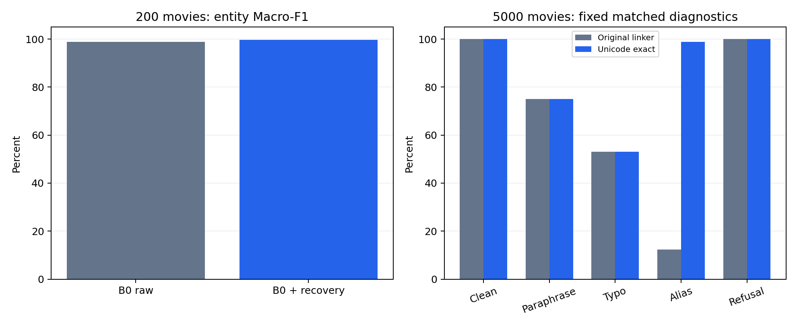

# 实验改进补充记录

本轮接续 2026 年 10 月 29 日实验，使用已上传的冻结数据，记录名称恢复与 Unicode 别名链接的实际改进。原两份个人 Word 报告继续保留 200 部电影的基础实验；本文件作为新增结果附录。

## 1. 两种系统为什么分数不同

A0 识别关系后直接查询已知图谱，答案名称来自图谱标签，因此受控模板题容易取得满分。B0 逐字生成答案，未知字符、人名拼写和多答案遗漏都会影响严格实体分数。两者都属于本项目，不能把 A0 的模板满分解释为所有问法满分。

## 2. 神经名称恢复：200 部电影

方法只读取问题实际链接到的电影及其最多 24 条可用事实。对分词器含未知 token 的降损名称，若在候选事实中唯一且完整匹配，就恢复原标签。歧义、已有正确名称、短片段、普通生成错误保持原文；不使用标准答案或金标准关系补答案。推理记录保存原始生成、替换位置、实体与恢复耗时。

| 划分 | B0 原始集合准确率 | 加恢复后集合准确率 | B0 原始实体 F1 | 加恢复后实体 F1 |
|---|---:|---:|---:|---:|
| 验证 373 题 | 99.20% | 100.00% | 99.20% | 100.00% |
| 测试 370 题 | 98.65% | 99.46% | 98.86% | 99.68% |

验证修复 3 题，测试修复 3 题，测试正确题退化 0 题。测试仍有两道错误：Scalps 漏掉一种类型，Ace of Aces 的 Gérard Oury 生成为 Gerd Oury。后者可被原分词器表示，不能归因于未知字符。原题、改写、错拼的准确率由 99/88/88 提高到 100/89/89；别名 47/47、拒答 34/34。

这是同一检查点的生成后处理实验，未重新训练，也不称为原始端到端模型成绩。先依据验证结果固定实现和版本哈希，再复评测试；该测试集此前已做过错误分析，因此属于后验改进复评，不能宣传为全新盲测。

## 3. 扩展 A0：5000 部电影

11 个上传资产共 40,422,065 字节，大小与 SHA-256 校验通过。5000 电影、7864 实体、35485 三元组、58994 QA；旧模型、阈值 0.30 和数据保持原值。固定模板测试 8917 题仍为 100.00%，逐题答案及实体集合与上传记录的一致性为 True。

旧链接器的 ASCII 规范化会删除中文。新增 Unicode 完整名称精确匹配，并在遮蔽后输出旧分类器使用的 movie_title；未知中文、同名、多电影、未知数字续集及疑似扩展继续拒答。ASCII 评分规范化和接受阈值保持原值，中文名称不做模糊猜测。中文标题应有空格或标点边界，关系提问仍为英文。

验证集模板准确率 100.00% → 100.00%；验证别名准确率 5.62% → 94.38%。下表是相同种子 42、相同测试来源题和扰动定义的复评：

| 测试诊断 | 题数 | 修复前集合准确率 | 修复后集合准确率 |
|---|---:|---:|---:|
| 原题 | 100 | 100.00% | 100.00% |
| 改写 | 100 | 75.00% | 75.00% |
| 错拼 | 100 | 53.00% | 53.00% |
| 别名 | 89 | 12.36% | 98.88% |
| 拒答 | 50 | 100.00% | 100.00% |

别名只与同源的 89 道原题配对，不用原题总数 100 当别名分母。抽样覆盖电影和关系，用于诊断，不代表所有自由提问的总体准确率。此前已观察测试问题，本次根据机制与验证集复核修复，未按测试结果搜索阈值。

唯一未答对的别名题使用“索拉力星”，它同时对应库中两部 Solaris（Q673195、Q125772）。系统返回歧义拒答，需要年份或 QID 消歧；没有为了获得满分而指定其中一部。

## 4. 扩展库神经训练预检

对全部 58994 题运行本地 T5TokenizerFast：训练 315、验证 69、测试 87 道目标文本含未知 token。训练有 10 道输入超过 384 token，最长 402；验证与测试没有输入截断，全部目标不超过 96 token，也未发生 24 条事实截断。

下一轮扩展训练需采用能覆盖长输入的统一配置并再次预检，重新训练该版本配套 TransE。原 200 部电影的神经权重与实体向量未混用为 5000 部电影模型；本轮没有新增其神经训练成绩。

## 5. 按两人分工归档

- 周新永：A0 与 Unicode 链接、歧义拒答、扩展鲁棒性和严格评测记录。
- 夏俊杰：分词器预检、神经名称恢复、检查点及结构映射一致性，保留未解决的生成错误。
- 共同：固定数据版本、对比分析与现场验收。真实独立人工评分和报告要求的终端截图仍需本人完成。

完整来源与逐题记录见 [神经恢复目录](../verification/2026-10-29/name_recovery/) 和 [扩展复评目录](../verification/2026-10-29/expanded_followup/)。这些新增成果按既定责任边界归档，不追认此前独立操作或人工评分。

最终本地检查为 **297 项测试通过，16.08 秒**；Python 编译、PowerShell 语法、两项 CLI 帮助、合成 CPU 验收及完整分发资产校验通过。见 [local_checks.json](../verification/2026-10-29/expanded_followup/local_checks.json)。
